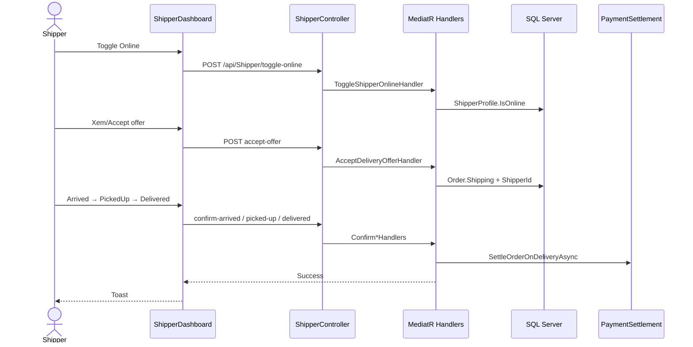

# Tài liệu Quy trình: Shipper giao hàng (Shipper Delivery)

Tài liệu mô tả luồng tài xế từ **bật online** → nhận đề xuất → giao hàng → báo cáo sự cố / uy tín trong hệ thống **Shopping Food**.

> Đơn phải ở `WaitingForShipper` (Seller gọi waiting-for-shipper) hoặc được Coordinator force-assign.  
> Xem thêm: [Checkout_Order_Workflow.md](./Checkout_Order_Workflow.md) · [Coordinator_Dispatch_Workflow.md](./Coordinator_Dispatch_Workflow.md) · [Payment_Requirements.md](./Payment_Requirements.md) (settle COD khi delivered).

---

## 1. Luồng Tổng Quan (Workflow)

1. **Online:** Shipper mở `/shipper` → bật online (`POST /api/Shipper/toggle-online`).
2. **Nhận đề xuất:** Poll `available-offers` **hoặc** nhận Notification Force-Assign / Broadcast → `proposed-offer/{orderId}`.
3. **Accept / Reject:** `accept-offer` hoặc `reject-offer` (kèm lat/lng).
4. **Accept OK:** Order `ShipperId` gán, `Status = Shipping`; proposal `Accepted`.
5. **Đến quán:** `confirm-arrived` (có thể kèm mã / GPS).
6. **Lấy hàng:** `confirm-picked-up`.
7. **GPS / lộ trình:** `location`, `delivery-route/{orderId}` trong lúc giao.
8. **Giao thành công:** `confirm-delivered` → `Delivered` + `SettleOrderOnDeliveryAsync` (Payment).
9. **Giao thất bại:** `confirm-failed` + lý do.
10. **Khác:** Báo cáo sự cố đơn, xem `ReputationHistory`, thu nhập, lịch/khu vực.



### Trạng thái đơn liên quan Shipper

```text
WaitingForShipper --accept/force-assign--> Shipping --confirm-delivered--> Delivered
                                      \--confirm-failed--> (failed handling / escalate)
```

---

## Bước 1: Bật / tắt Online

**Thông tin:**
- **URL (FE):** `/shipper` (ShipperDashboard)
- **API:** `POST /api/Shipper/toggle-online`
- **HTTP Method:** POST
- **Auth:** Role **Shipper**

### 1.1. Frontend

**File:** `ShoppingFood.FE/src/pages/shipper/ShipperDashboard.tsx`  
**Service:** `ShoppingFood.FE/src/services/ShipperService.ts`

```typescript
async toggleOnline(data: IToggleShipperOnlineRequest): Promise<IApiResponse<any>> {
  return httpClient.post(API_ENDPOINTS.SHIPPER.TOGGLE_ONLINE, data);
}
```

**Toast:**
- Success: `Bạn đã BẬT trạng thái trực tuyến!` / `Bạn đã TẮT...`
- Error: `Không thể thay đổi trạng thái...` / message suspended

### 1.2. Controller

**File:** `src/ShoppingFood.API/Controllers/ShipperController.cs` — Lines 20–25

```csharp
[HttpPost("toggle-online")]
public async Task<ActionResult<ApiResponse>> ToggleOnline([FromBody] ToggleShipperOnlineCommand command)
{
    var response = await _mediator.Send(command);
    return StatusCode(response.Code, response);
}
```

### 1.3. Handler

**File:** `src/ShoppingFood.Application/Features/Users/Commands/ToggleShipperOnlineHandler.cs`  
**Class:** `ToggleShipperOnlineHandler`

```csharp
if (userProfile == null || userProfile.Role != UserRole.Shipper)
    return ApiResponse.Failure(403, "Forbidden. Only shipper can toggle online status.");

// SuspendedUntil còn hiệu lực → 403 + lý do / phút còn lại
shipperProfile.IsOnline = request.IsOnline;
shipperProfile.UpdatedAt = DateTime.UtcNow;
```

**DB:** `SHIPPER_PROFILE.IsOnline`, `SuspendedUntil`, `SuspendedReason`.

---

## Bước 2: Xem đề xuất / đơn khả dụng

### 2.1. Available offers

| Mục | Chi tiết |
|-----|----------|
| **API** | `GET /api/Shipper/available-offers?latitude=&longitude=` |
| **Controller** | `GetAvailableOffers` (L151–165) |
| **Query** | `GetAvailableOrdersForShipperQuery` |
| **FE** | `shipperService.getAvailableOffers(lat, lng)` |

### 2.2. Proposed offer (1 đơn)

| Mục | Chi tiết |
|-----|----------|
| **API** | `GET /api/Shipper/proposed-offer/{orderId}?latitude=&longitude=` |
| **Controller** | `GetProposedOffer` (L26–36) |
| **Query** | `GetProposedDeliveryOfferQuery` |
| **FE** | Popup `OrderProposalPopup` / sau Force-Assign notification |

**Controller:**

```csharp
[HttpGet("proposed-offer/{orderId}")]
public async Task<ActionResult<ApiResponse>> GetProposedOffer(Guid orderId, [FromQuery] double latitude, [FromQuery] double longitude)
{
    var query = new GetProposedDeliveryOfferQuery { OrderId = orderId, Latitude = latitude, Longitude = longitude };
    if (userDto != null) query.CurrentUserId = userDto.Id;
    var response = await _mediator.Send(query);
    return StatusCode(response.Code, response);
}
```

**Realtime:** `ShipperDashboard` listen notification Force Assign → gọi `getProposedOffer` → toast `Bạn vừa được điều phối viên gán trực tiếp một đơn hàng mới!`

---

## Bước 3: Accept / Reject offer

### 3.1. Accept

**API:** `POST /api/Shipper/accept-offer`  
**Controller:** L38–43  
**Handler:** `src/ShoppingFood.Application/Features/Orders/Commands/AcceptDeliveryOfferHandler.cs`

**Rules (Handle):**

```csharp
if (!shipperProfile.IsOnline)
    return ApiResponse.Failure(400, "Drivers must switch to online status to receive orders.");
if (order.ShipperId.HasValue)
    return ApiResponse.Failure(400, "This order has been accepted by another driver.");
if (order.Status != OrderStatus.WaitingForShipper)
    return ApiResponse.Failure(400, $"The order is not in waiting for shipper status...");

AssignOrderToShipper(order, shipperProfile.Id); // Status = Shipping
// Update proposal Accepted + DispatchHistory + Notify customer
```

**FE toast:** `Nhận đơn thành công!` / `Đã chấp nhận đơn hàng!`

### 3.2. Reject

**API:** `POST /api/Shipper/reject-offer`  
**Handler:** `RejectDeliveryOfferHandler.cs`  
**FE:** Prompt lý do → `rejectOffer` → toast `Đã từ chối đơn hàng`  
**DB:** `ORDER_DELIVERY_PROPOSAL.Status = Rejected` (+ history)

---

## Bước 4: Arrived → Picked up → Delivered / Failed

### 4.1. Confirm arrived

| Mục | Chi tiết |
|-----|----------|
| **API** | `POST /api/Shipper/confirm-arrived` |
| **Controller** | L45–54 — gán `CurrentUserId` từ `userDto` |
| **Handler** | `ConfirmArrivedAtRestaurantHandler.cs` |
| **FE** | Dashboard cập nhật bước lấy hàng |

### 4.2. Confirm picked up

| Mục | Chi tiết |
|-----|----------|
| **API** | `POST /api/Shipper/confirm-picked-up` |
| **Handler** | `ConfirmPickedUpHandler.cs` |
| **UI** | Có thể dùng `PickupCodeModal` |

### 4.3. Update location

| Mục | Chi tiết |
|-----|----------|
| **API** | `POST /api/Shipper/location` |
| **Handler** | `UpdateShipperLocationCommand` |
| **DB** | `SHIPPER_PROFILE.Latitude/Longitude` |

### 4.4. Delivery route

| Mục | Chi tiết |
|-----|----------|
| **API** | `GET /api/Shipper/delivery-route/{orderId}` |
| **Query** | `GetDeliveryRouteQuery` |

### 4.5. Confirm delivered (quan trọng — tài chính)

**API:** `POST /api/Shipper/confirm-delivered`  
**Handler:** `ConfirmDeliverySuccessHandler.cs`

```csharp
if (order.Status != OrderStatus.Shipping) // fail otherwise
order.Status = OrderStatus.Delivered;
await _paymentSettlementService.SettleOrderOnDeliveryAsync(order, shipperProfile);
```

> Chi tiết chia tiền / công nợ COD: [Payment_Requirements.md](./Payment_Requirements.md).

**FE:** `SuccessDeliveryModal` → `confirmDelivered`.

### 4.6. Confirm failed

**API:** `POST /api/Shipper/confirm-failed`  
**Handler:** `ConfirmDeliveryFailedHandler.cs`  
**FE toast:** `Đã báo cáo giao hàng thất bại.` / lỗi mạng

---

## Bước 5: Báo cáo sự cố đơn

**API:** `POST /api/Shipper/Orders/{orderId}/report`  
**Controller:** L199–208  
**Command:** `ReportOrderIncidentCommand`  
**FE:** `ReportIncidentModal` → `shipperService.reportOrderIncident`  
**DB:** `SYSTEM_REPORT` (target Order/Shipper…) → Coordinator xem incidents

```csharp
[HttpPost("Orders/{orderId}/report")]
public async Task<ActionResult<ApiResponse>> ReportOrderIncident(Guid orderId, [FromBody] ReportOrderIncidentCommand command)
{
    command.OrderId = orderId;
    if (userDto != null) command.CurrentUserId = userDto.Id;
    var response = await _mediator.Send(command);
    return StatusCode(response.Code, response);
}
```

---

## Bước 6: Uy tín, thu nhập, lịch khu vực

| API | Handler / Query | FE |
|-----|-----------------|-----|
| `GET /api/Shipper/ReputationHistory` | `GetReputationHistoryQuery` | `ShipperReputationTab` |
| `GET /api/Shipper/income-report` | `GetShipperIncomeReportQuery` | `ShipperIncomePage` |
| `GET/PUT /api/Shipper/schedule-area` | Get/Update schedule | Profile |
| `POST /api/Shipper/review` | `CreateShipperReviewCommand` | Customer review shipper sau giao |

Coordinator có thể **adjust reputation** / **suspend** — xem Coordinator workflow.

**Thu hồi đơn:** Notification release → Dashboard toast `Đơn hàng đã bị thu hồi!` và gỡ khỏi list.

---

## Sơ đồ file đi qua (Call chain)

```text
ShipperDashboard.tsx (+ OrderProposalPopup, SuccessDeliveryModal, ReportIncidentModal)
  ↓
ShipperService.ts
  ↓
ShipperController.cs
  ↓
ToggleShipperOnlineHandler
AcceptDeliveryOfferHandler / RejectDeliveryOfferHandler
ConfirmArrivedAtRestaurantHandler / ConfirmPickedUpHandler
ConfirmDeliverySuccessHandler / ConfirmDeliveryFailedHandler
UpdateShipperLocation / GetDeliveryRoute / ReportOrderIncident
  ↓
ORDER, SHIPPER_PROFILE, ORDER_DELIVERY_PROPOSAL, ORDER_DISPATCH_HISTORY,
NOTIFICATION, SYSTEM_REPORT, WALLET (settle)
```

| Vai trò | Đường dẫn |
|---------|-----------|
| FE Dashboard | `ShoppingFood.FE/src/pages/shipper/ShipperDashboard.tsx` |
| FE Service | `ShoppingFood.FE/src/services/ShipperService.ts` |
| Controller | `src/ShoppingFood.API/Controllers/ShipperController.cs` |
| Toggle online | `.../Users/Commands/ToggleShipperOnlineHandler.cs` |
| Accept offer | `.../Orders/Commands/AcceptDeliveryOfferHandler.cs` |
| Delivered | `.../Orders/Commands/ConfirmDeliverySuccessHandler.cs` |
| Payment settle | `.../Services/PaymentSettlementService.cs` |

---

## Các thông báo (Toast)

| Message | Trigger |
|---------|---------|
| Bạn đã BẬT/TẮT trạng thái trực tuyến! | toggle-online |
| Vui lòng bật trạng thái trực tuyến để nhận đơn | Accept khi offline |
| Nhận đơn thành công! / Đã chấp nhận đơn hàng! | accept-offer |
| Đã từ chối đơn hàng | reject-offer |
| Đã hết thời gian phản hồi đề xuất. | Timeout popup |
| Force Assign / gán trực tiếp… | SignalR notification |
| Đơn hàng đã bị thu hồi! | Release từ Coordinator |
| Đã báo cáo giao hàng thất bại. | confirm-failed |

---

## Các cơ chế bảo mật / ràng buộc

1. Chỉ role **Shipper** + profile **Active** mới toggle/nhận đơn.
2. **Phải online** mới accept; tài khoản **Suspended** bị chặn (permanent hoặc còn phút).
3. Chỉ nhận đơn `WaitingForShipper` và **chưa có** `ShipperId` (tránh double-accept).
4. Delivered chỉ từ `Shipping`; settle tài chính **idempotent** (`IsFinancialSettled`).
5. GPS gửi kèm accept/location để tính khoảng cách / monitoring.
6. Force-assign / release từ Coordinator ghi `ORDER_DISPATCH_HISTORY` + push notification.

---

## Checklist tự test

- [ ] Toggle online/offline; bị suspend thì không bật được
- [ ] Seller đưa đơn sang WaitingForShipper → xuất hiện available/proposed
- [ ] Accept → Status Shipping; shipper khác không nhận được
- [ ] Reject → proposal Rejected
- [ ] Arrived → PickedUp → Delivered; ví/COD cập nhật (Payment)
- [ ] Confirm failed + report incident hiện ở Coordinator
- [ ] Force-assign từ Coord → toast + đơn vào dashboard
- [ ] Release → đơn biến mất khỏi shipper

---

## Tóm tắt

Shipper vận hành trên `ShipperDashboard`: **Online → Offer → Shipping pipeline → Delivered/Failed**. Accept gắn `ShipperId` và `OrderStatus.Shipping`; Delivered kích hoạt **settlement tài chính**. Điều phối thủ công nằm ở Coordinator workflow.

> [Checkout_Order](./Checkout_Order_Workflow.md) · [Coordinator_Dispatch](./Coordinator_Dispatch_Workflow.md) · [Payment_Requirements](./Payment_Requirements.md)
