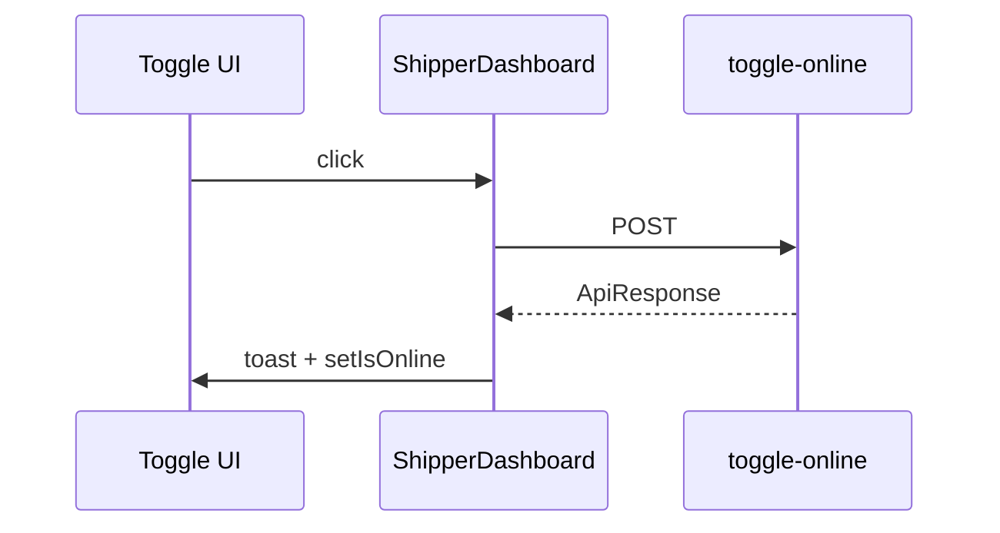
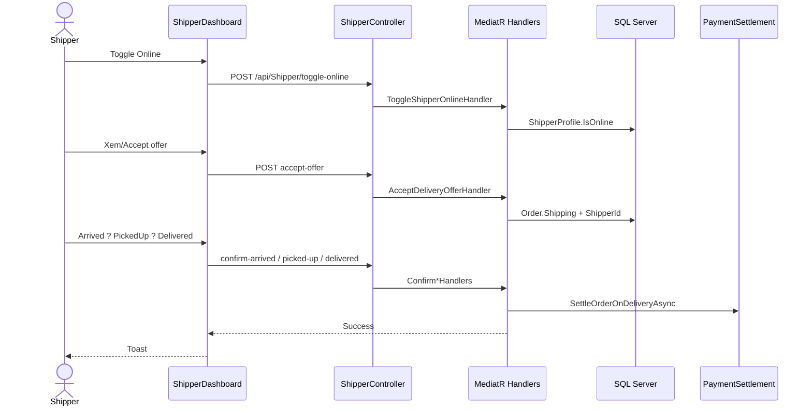

# Tài li?u Quy trình: Shipper giao hàng (Shipper Delivery)

Tài li?u mô t? lu?ng tài x? t? **b?t online** ? nh?n d? xu?t ? giao hàng ? báo cáo s? c? / uy tín trong h? th?ng **UniEats**.

> Ðon ph?i ? `WaitingForShipper` (Seller g?i waiting-for-shipper) ho?c du?c Coordinator force-assign.  
> Xem thêm: [Checkout_Order_Workflow.md](./Checkout_Order_Workflow.md) · [Coordinator_Dispatch_Workflow.md](./Coordinator_Dispatch_Workflow.md) · [Payment_Requirements.md](./Payment_Requirements.md) (settle COD khi delivered).

---


---

## Ph?n A — UI Interaction Trace (Nút b?m ? Code ? Data ? Hi?n th?)

> UI Trace — Shipper  
> M?i thao tác tr? l?i: **nút ? dâu** · **b?m ch?y file/hàm nào** · **API/BE dâu** · **data tr? v?** · **hi?n th? th? nào**.


**Route:** `/shipper` · **Page:** `pages/shipper/ShipperDashboard.tsx`  
**Service:** `services/ShipperService.ts`

---

## UT-SHP-01 — Toggle **?B?t / T?t tr?c tuy?n?**

### 1. Giao di?n nút ? dâu?

| M?c | Giá tr? |
|-----|---------|
| **Route** | `/shipper` |
| **Page** | `ShipperDashboard.tsx` |
| **Control** | Toggle / button `onClick={handleToggleOnline}` (~605) |
| **Nhãn UX** | B?T / T?T tr?ng thái tr?c tuy?n |

### 2. FE ch?y dâu?

```text
onClick
  ? handleToggleOnline (ShipperDashboard.tsx ~385+)
       · newStatus = !isOnline
  ? shipperService.toggleOnline({ isOnline: newStatus })
  ? HttpClient POST /api/Shipper/toggle-online
```

### 3. BE ch?y dâu?

```text
ShipperController ? ToggleShipperOnlineHandler
  ? Ki?m tra role Shipper, profile t?n t?i
  ? N?u Suspended ? Failure 403 + lý do / th?i gian còn
  ? IsOnline = newStatus ? Save
```

### 4. Data tr? v?

```json
{ "code": 200, "error": false, "message": "...", "data": null }
```
Ho?c `error: true`, `message`: `"Tài kho?n c?a b?n dã b? khóa. Lý do: ..."`

### 5. Hi?n th?

| Nhánh | UI |
|-------|-----|
| OK | `setIsOnline(newStatus)` + `toast.success('B?n dã B?T/T?T tr?ng thái tr?c tuy?n!')` |
| Fail | `toast.error(res.message \|\| ...)` — **không** d?i toggle |

### 6. Sequence



---

## UT-SHP-02 — Nút **?Nh?n don?** trên card Available Offers

### 1. UI ? dâu?

| M?c | Giá tr? |
|-----|---------|
| **Vùng** | Danh sách available offers trên Dashboard |
| **Nút** | Accept trên card — `onClick` ? `handleAcceptOffer(offer.orderId)` (~860) |
| **Nút ph?** | Reject ? `handleRejectOffer` (~874) |
| **Click card** | `setProposalPopupOffer(offer)` m? popup |

### 2. FE

```text
handleAcceptOffer(orderId)
  ? n?u !isOnline: toast.error('Vui lòng b?t tr?ng thái tr?c tuy?n d? nh?n don'); return
  ? shipperService.acceptOffer({ orderId })
  ? POST /api/Shipper/accept-offer
  ? success: toast 'Ðã ch?p nh?n don hàng!' + refresh active delivery / offers
```

### 3. BE

```text
Accept offer handler
  ? Gán ShipperId lên Order, Proposal Accepted
  ? Có th? t?o notification cho Customer/Seller
```

### 4–5. Data & hi?n th?

- Success: toast + `fetchAvailableOffers` / set `activeDelivery`  
- Error API: `toast.error(err.response?.data?.message || 'Không th? nh?n don...')`

---

## UT-SHP-03 — Popup d? xu?t **OrderProposalPopup** (Accept / Reject / Timeout)

### 1. UI

| M?c | Giá tr? |
|-----|---------|
| **Component** | `pages/shipper/components/OrderProposalPopup.tsx` |
| **M? khi** | Coordinator broadcast / force-assign / click card ? `proposalPopupOffer` state |
| **Nút** | Accept ? `onAccept={handleAcceptProposal}` · Reject ? `handleRejectProposal` |
| **Timeout** | Timer trong popup ? `handleTimeoutProposal` |

### 2. FE

```text
handleAcceptProposal(orderId) (~271)
  ? POST /Shipper/accept-offer
  ? toast.success('Nh?n don thành công!')
  ? dóng popup, dua don vào active

handleRejectProposal ? POST /Shipper/reject-offer
handleTimeoutProposal ? toast.error('Ðã h?t th?i gian ph?n h?i d? xu?t.')
```

**Force-assign qua SignalR** (~228): toast ? `GET /Shipper/proposed-offer/{orderId}` ? m? popup / set active.

### 3–5. BE / hi?n th?

- Accept/Reject handlers c?p nh?t `OrderDeliveryProposal` + Order  
- Thu h?i: toast.error `'Ðon hàng dã b? thu h?i!...'` (~257)

---

## UT-SHP-04 — Nút **?Ðã d?n quán?** / **?Ðã l?y hàng?**

### 1. UI

Trên card **active delivery** — các bu?c:

| Nhãn UX | Handler | API |
|---------|---------|-----|
| Ð?n quán / Next step | `handleStepTransition` ? confirm-arrived ho?c confirm-picked-up tùy status | `POST /Shipper/confirm-arrived` · `confirm-picked-up` |
| (~756) | `onClick={() => handleStepTransition(activeDelivery.orderId)}` | |

### 2. FE (~431+)

```text
handleStepTransition(orderId)
  ? shipperService.confirmArrived / confirmPickedUp (theo bu?c hi?n t?i)
  ? c?p nh?t local activeDelivery status
  ? l?i: toast.error('Ðon hàng không còn h?p l? ho?c dã b? thu h?i.')
```

### 3. BE

Handlers d?i `OrderStatus` / tr?ng thái giao tuong ?ng.

### 5. Hi?n th?

- UI bu?c ti?n trên card (không nh?t thi?t toast success m?i bu?c — xem code nhánh success)
- Fail: toast error

---

## UT-SHP-05 — Nút **?Giao thành công?** ? SuccessDeliveryModal

### 1. UI

| M?c | Giá tr? |
|-----|---------|
| **Nút** | M? modal — `setSuccessModalOrderId(activeDelivery.orderId)` (~766) |
| **Modal** | `components/SuccessDeliveryModal.tsx` |
| **Trong modal** | Upload ?nh ch?ng minh + nút xác nh?n giao |

### 2. FE

```text
SuccessDeliveryModal submit
  ? (upload ?nh n?u c?n) authService.uploadImage / UploadImage
  ? shipperService.confirmDelivered({ orderId, proofImageUrl? })
  ? POST /api/Shipper/confirm-delivered
```

### 3. BE

```text
ConfirmDelivered handler
  ? Order status Delivered
  ? PaymentSettlementService.SettleOrderOnDeliveryAsync
       · C?ng ví Seller / Shipper / Platform (xem Revenue_Split)
  ? ApiResponse success
```

### 4. Data tr? v?

`{ error: false, message: "..." }` — settle x?y ra server-side.

### 5. Hi?n th?

| Success | `toast` trong modal: `'Chúc m?ng! Giao hàng thành công.'` · dóng modal · xóa activeDelivery · refresh income n?u có |
| Thi?u ?nh | `toast.error('Vui lòng t?i ?nh ch?ng minh giao hàng')` |

---

## UT-SHP-06 — Nút **?Giao th?t b?i?** (PromptModal)

### 1. UI

```text
onClick ? handleDeliveryFailedClick(orderId) (~773)
  ? m? PromptModal nh?p lý do
  ? confirm ? POST /Shipper/confirm-failed
```

### 5. Hi?n th?

- Hi?n code: `toast.error('Ðã báo cáo giao hàng th?t b?i.')` sau khi g?i OK (dùng error toast — xem AL-SHP-12)

---

## UT-SHP-07 — Nút **?Báo cáo s? c??** ? ReportIncidentModal

### 1. UI

| M?c | Giá tr? |
|-----|---------|
| **M?** | `setReportModalOrderId(...)` (~786) |
| **Modal** | `ReportIncidentModal.tsx` |
| **Nút g?i** | Submit form chi ti?t s? c? |

### 2–5

```text
? shipperService.reportOrder / POST /Shipper/Orders/{orderId}/report
? toast.success('G?i báo cáo s? c? thành công. Coordinator s? xem xét...')
? dóng modal
```

Validation: `toast.error('Vui lòng nh?p chi ti?t s? c?')`

---

## UT-SHP-08 — Nút **?Làm m?i?** danh sách offers

```text
onClick={fetchAvailableOffers} (~814, ~893)
  ? GET /Shipper/available-offers
  ? setOffers(res.data)
  ? n?u offline/API l?i: toast theo message BE
```

---

## B?ng tóm t?t Shipper

| ID | Nhãn | FE hàm | API | Hi?n th? |
|----|------|--------|-----|----------|
| UT-SHP-01 | Toggle online | handleToggleOnline | POST toggle-online | toast B?T/T?T |
| UT-SHP-02 | Nh?n don (card) | handleAcceptOffer | accept-offer | toast + refresh |
| UT-SHP-03 | Popup accept/reject | handleAcceptProposal… | accept/reject-offer | toast + dóng popup |
| UT-SHP-04 | Ð?n quán / l?y hàng | handleStepTransition | confirm-arrived/picked-up | c?p nh?t bu?c UI |
| UT-SHP-05 | Giao thành công | SuccessDeliveryModal | confirm-delivered | toast chúc m?ng + settle |
| UT-SHP-06 | Giao th?t b?i | PromptModal | confirm-failed | toast |
| UT-SHP-07 | Báo s? c? | ReportIncidentModal | Orders/{id}/report | toast success |
| UT-SHP-08 | Refresh offers | fetchAvailableOffers | available-offers | re-render list |

## File neo

| File |
|------|
| `ShoppingFood.FE/src/pages/shipper/ShipperDashboard.tsx` |
| `.../components/OrderProposalPopup.tsx` |
| `.../components/SuccessDeliveryModal.tsx` |
| `.../components/ReportIncidentModal.tsx` |
| `ShoppingFood.FE/src/services/ShipperService.ts` |
| `src/ShoppingFood.API/Controllers/ShipperController.cs` |
| `Application/Services/PaymentSettlementService.SettleOrderOnDeliveryAsync` |


---

## Ph?n B — Workflow nghi?p v? & Backend (chi ti?t lu?ng)
## 1. Lu?ng T?ng Quan (Workflow)

1. **Online:** Shipper m? `/shipper` ? b?t online (`POST /api/Shipper/toggle-online`).
2. **Nh?n d? xu?t:** Poll `available-offers` **ho?c** nh?n Notification Force-Assign / Broadcast ? `proposed-offer/{orderId}`.
3. **Accept / Reject:** `accept-offer` ho?c `reject-offer` (kèm lat/lng).
4. **Accept OK:** Order `ShipperId` gán, `Status = Shipping`; proposal `Accepted`.
5. **Ð?n quán:** `confirm-arrived` (có th? kèm mã / GPS).
6. **L?y hàng:** `confirm-picked-up`.
7. **GPS / l? trình:** `location`, `delivery-route/{orderId}` trong lúc giao.
8. **Giao thành công:** `confirm-delivered` ? `Delivered` + `SettleOrderOnDeliveryAsync` (Payment).
9. **Giao th?t b?i:** `confirm-failed` + lý do.
10. **Khác:** Báo cáo s? c? don, xem `ReputationHistory`, thu nh?p, l?ch/khu v?c.



### Tr?ng thái don liên quan Shipper

```text
WaitingForShipper --accept/force-assign--> Shipping --confirm-delivered--> Delivered
                                      \--confirm-failed--> (failed handling / escalate)
```

---

## Bu?c 1: B?t / t?t Online

**Thông tin:**
- **URL (FE):** `/shipper` (ShipperDashboard)
- **API:** `POST /api/Shipper/toggle-online`
- **HTTP Method:** POST
- **Auth:** Role **Shipper**

### 1.1. Frontend

**File:** `ShoppingFood.FE/src/pages/shipper/ShipperDashboard.tsx`  
**Service:** `ShoppingFood.FE/src/services/ShipperService.ts`

```typescript
async toggleOnline(data: IToggleShipperOnlineRequest): Promise<IApiResponse<any>> {
  return httpClient.post(API_ENDPOINTS.SHIPPER.TOGGLE_ONLINE, data);
}
```

**Toast:**
- Success: `B?n dã B?T tr?ng thái tr?c tuy?n!` / `B?n dã T?T...`
- Error: `Không th? thay d?i tr?ng thái...` / message suspended

### 1.2. Controller

**File:** `src/ShoppingFood.API/Controllers/ShipperController.cs` — Lines 20–25

```csharp
[HttpPost("toggle-online")]
public async Task<ActionResult<ApiResponse>> ToggleOnline([FromBody] ToggleShipperOnlineCommand command)
{
    var response = await _mediator.Send(command);
    return StatusCode(response.Code, response);
}
```

### 1.3. Handler

**File:** `src/ShoppingFood.Application/Features/Users/Commands/ToggleShipperOnlineHandler.cs`  
**Class:** `ToggleShipperOnlineHandler`

```csharp
if (userProfile == null || userProfile.Role != UserRole.Shipper)
    return ApiResponse.Failure(403, "Forbidden. Only shipper can toggle online status.");

// SuspendedUntil còn hi?u l?c ? 403 + lý do / phút còn l?i
shipperProfile.IsOnline = request.IsOnline;
shipperProfile.UpdatedAt = DateTime.UtcNow;
```

**DB:** `SHIPPER_PROFILE.IsOnline`, `SuspendedUntil`, `SuspendedReason`.

---

## Bu?c 2: Xem d? xu?t / don kh? d?ng

### 2.1. Available offers

| M?c | Chi ti?t |
|-----|----------|
| **API** | `GET /api/Shipper/available-offers?latitude=&longitude=` |
| **Controller** | `GetAvailableOffers` (L151–165) |
| **Query** | `GetAvailableOrdersForShipperQuery` |
| **FE** | `shipperService.getAvailableOffers(lat, lng)` |

### 2.2. Proposed offer (1 don)

| M?c | Chi ti?t |
|-----|----------|
| **API** | `GET /api/Shipper/proposed-offer/{orderId}?latitude=&longitude=` |
| **Controller** | `GetProposedOffer` (L26–36) |
| **Query** | `GetProposedDeliveryOfferQuery` |
| **FE** | Popup `OrderProposalPopup` / sau Force-Assign notification |

**Controller:**

```csharp
[HttpGet("proposed-offer/{orderId}")]
public async Task<ActionResult<ApiResponse>> GetProposedOffer(Guid orderId, [FromQuery] double latitude, [FromQuery] double longitude)
{
    var query = new GetProposedDeliveryOfferQuery { OrderId = orderId, Latitude = latitude, Longitude = longitude };
    if (userDto != null) query.CurrentUserId = userDto.Id;
    var response = await _mediator.Send(query);
    return StatusCode(response.Code, response);
}
```

**Realtime:** `ShipperDashboard` listen notification Force Assign ? g?i `getProposedOffer` ? toast `B?n v?a du?c di?u ph?i viên gán tr?c ti?p m?t don hàng m?i!`

---

## Bu?c 3: Accept / Reject offer

### 3.1. Accept

**API:** `POST /api/Shipper/accept-offer`  
**Controller:** L38–43  
**Handler:** `src/ShoppingFood.Application/Features/Orders/Commands/AcceptDeliveryOfferHandler.cs`

**Rules (Handle):**

```csharp
if (!shipperProfile.IsOnline)
    return ApiResponse.Failure(400, "Drivers must switch to online status to receive orders.");
if (order.ShipperId.HasValue)
    return ApiResponse.Failure(400, "This order has been accepted by another driver.");
if (order.Status != OrderStatus.WaitingForShipper)
    return ApiResponse.Failure(400, $"The order is not in waiting for shipper status...");

AssignOrderToShipper(order, shipperProfile.Id); // Status = Shipping
// Update proposal Accepted + DispatchHistory + Notify customer
```

**FE toast:** `Nh?n don thành công!` / `Ðã ch?p nh?n don hàng!`

### 3.2. Reject

**API:** `POST /api/Shipper/reject-offer`  
**Handler:** `RejectDeliveryOfferHandler.cs`  
**FE:** Prompt lý do ? `rejectOffer` ? toast `Ðã t? ch?i don hàng`  
**DB:** `ORDER_DELIVERY_PROPOSAL.Status = Rejected` (+ history)

---

## Bu?c 4: Arrived ? Picked up ? Delivered / Failed

### 4.1. Confirm arrived

| M?c | Chi ti?t |
|-----|----------|
| **API** | `POST /api/Shipper/confirm-arrived` |
| **Controller** | L45–54 — gán `CurrentUserId` t? `userDto` |
| **Handler** | `ConfirmArrivedAtRestaurantHandler.cs` |
| **FE** | Dashboard c?p nh?t bu?c l?y hàng |

### 4.2. Confirm picked up

| M?c | Chi ti?t |
|-----|----------|
| **API** | `POST /api/Shipper/confirm-picked-up` |
| **Handler** | `ConfirmPickedUpHandler.cs` |
| **UI** | Có th? dùng `PickupCodeModal` |

### 4.3. Update location

| M?c | Chi ti?t |
|-----|----------|
| **API** | `POST /api/Shipper/location` |
| **Handler** | `UpdateShipperLocationCommand` |
| **DB** | `SHIPPER_PROFILE.Latitude/Longitude` |

### 4.4. Delivery route

| M?c | Chi ti?t |
|-----|----------|
| **API** | `GET /api/Shipper/delivery-route/{orderId}` |
| **Query** | `GetDeliveryRouteQuery` |

### 4.5. Confirm delivered (quan tr?ng — tài chính)

**API:** `POST /api/Shipper/confirm-delivered`  
**Handler:** `ConfirmDeliverySuccessHandler.cs`

```csharp
if (order.Status != OrderStatus.Shipping) // fail otherwise
order.Status = OrderStatus.Delivered;
await _paymentSettlementService.SettleOrderOnDeliveryAsync(order, shipperProfile);
```

> Chi ti?t chia ti?n / công n? COD: [Payment_Requirements.md](./Payment_Requirements.md).

**FE:** `SuccessDeliveryModal` ? `confirmDelivered`.

### 4.6. Confirm failed

**API:** `POST /api/Shipper/confirm-failed`  
**Handler:** `ConfirmDeliveryFailedHandler.cs`  
**FE toast:** `Ðã báo cáo giao hàng th?t b?i.` / l?i m?ng

---

## Bu?c 5: Báo cáo s? c? don

**API:** `POST /api/Shipper/Orders/{orderId}/report`  
**Controller:** L199–208  
**Command:** `ReportOrderIncidentCommand`  
**FE:** `ReportIncidentModal` ? `shipperService.reportOrderIncident`  
**DB:** `SYSTEM_REPORT` (target Order/Shipper…) ? Coordinator xem incidents

```csharp
[HttpPost("Orders/{orderId}/report")]
public async Task<ActionResult<ApiResponse>> ReportOrderIncident(Guid orderId, [FromBody] ReportOrderIncidentCommand command)
{
    command.OrderId = orderId;
    if (userDto != null) command.CurrentUserId = userDto.Id;
    var response = await _mediator.Send(command);
    return StatusCode(response.Code, response);
}
```

---

## Bu?c 6: Uy tín, thu nh?p, l?ch khu v?c

| API | Handler / Query | FE |
|-----|-----------------|-----|
| `GET /api/Shipper/ReputationHistory` | `GetReputationHistoryQuery` | `ShipperReputationTab` |
| `GET /api/Shipper/income-report` | `GetShipperIncomeReportQuery` | `ShipperIncomePage` |
| `GET/PUT /api/Shipper/schedule-area` | Get/Update schedule | Profile |
| `POST /api/Shipper/review` | `CreateShipperReviewCommand` | Customer review shipper sau giao |

Coordinator có th? **adjust reputation** / **suspend** — xem Coordinator workflow.

**Thu h?i don:** Notification release ? Dashboard toast `Ðon hàng dã b? thu h?i!` và g? kh?i list.

---

## So d? file di qua (Call chain)

```text
ShipperDashboard.tsx (+ OrderProposalPopup, SuccessDeliveryModal, ReportIncidentModal)
  ?
ShipperService.ts
  ?
ShipperController.cs
  ?
ToggleShipperOnlineHandler
AcceptDeliveryOfferHandler / RejectDeliveryOfferHandler
ConfirmArrivedAtRestaurantHandler / ConfirmPickedUpHandler
ConfirmDeliverySuccessHandler / ConfirmDeliveryFailedHandler
UpdateShipperLocation / GetDeliveryRoute / ReportOrderIncident
  ?
ORDER, SHIPPER_PROFILE, ORDER_DELIVERY_PROPOSAL, ORDER_DISPATCH_HISTORY,
NOTIFICATION, SYSTEM_REPORT, WALLET (settle)
```

| Vai trò | Ðu?ng d?n |
|---------|-----------|
| FE Dashboard | `ShoppingFood.FE/src/pages/shipper/ShipperDashboard.tsx` |
| FE Service | `ShoppingFood.FE/src/services/ShipperService.ts` |
| Controller | `src/ShoppingFood.API/Controllers/ShipperController.cs` |
| Toggle online | `.../Users/Commands/ToggleShipperOnlineHandler.cs` |
| Accept offer | `.../Orders/Commands/AcceptDeliveryOfferHandler.cs` |
| Delivered | `.../Orders/Commands/ConfirmDeliverySuccessHandler.cs` |
| Payment settle | `.../Services/PaymentSettlementService.cs` |

---

## Các thông báo (Toast)

| Message | Trigger |
|---------|---------|
| B?n dã B?T/T?T tr?ng thái tr?c tuy?n! | toggle-online |
| Vui lòng b?t tr?ng thái tr?c tuy?n d? nh?n don | Accept khi offline |
| Nh?n don thành công! / Ðã ch?p nh?n don hàng! | accept-offer |
| Ðã t? ch?i don hàng | reject-offer |
| Ðã h?t th?i gian ph?n h?i d? xu?t. | Timeout popup |
| Force Assign / gán tr?c ti?p… | SignalR notification |
| Ðon hàng dã b? thu h?i! | Release t? Coordinator |
| Ðã báo cáo giao hàng th?t b?i. | confirm-failed |

---

## Các co ch? b?o m?t / ràng bu?c

1. Ch? role **Shipper** + profile **Active** m?i toggle/nh?n don.
2. **Ph?i online** m?i accept; tài kho?n **Suspended** b? ch?n (permanent ho?c còn phút).
3. Ch? nh?n don `WaitingForShipper` và **chua có** `ShipperId` (tránh double-accept).
4. Delivered ch? t? `Shipping`; settle tài chính **idempotent** (`IsFinancialSettled`).
5. GPS g?i kèm accept/location d? tính kho?ng cách / monitoring.
6. Force-assign / release t? Coordinator ghi `ORDER_DISPATCH_HISTORY` + push notification.

---

## Checklist t? test

- [ ] Toggle online/offline; b? suspend thì không b?t du?c
- [ ] Seller dua don sang WaitingForShipper ? xu?t hi?n available/proposed
- [ ] Accept ? Status Shipping; shipper khác không nh?n du?c
- [ ] Reject ? proposal Rejected
- [ ] Arrived ? PickedUp ? Delivered; ví/COD c?p nh?t (Payment)
- [ ] Confirm failed + report incident hi?n ? Coordinator
- [ ] Force-assign t? Coord ? toast + don vào dashboard
- [ ] Release ? don bi?n m?t kh?i shipper

---

## Tóm t?t

Shipper v?n hành trên `ShipperDashboard`: **Online ? Offer ? Shipping pipeline ? Delivered/Failed**. Accept g?n `ShipperId` và `OrderStatus.Shipping`; Delivered kích ho?t **settlement tài chính**. Ði?u ph?i th? công n?m ? Coordinator workflow.

> [Checkout_Order](./Checkout_Order_Workflow.md) · [Coordinator_Dispatch](./Coordinator_Dispatch_Workflow.md) · [Payment_Requirements](./Payment_Requirements.md)
