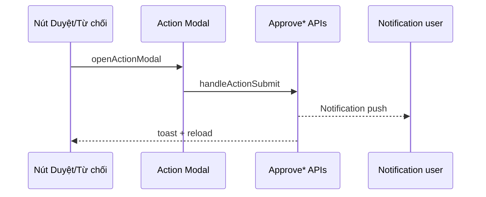
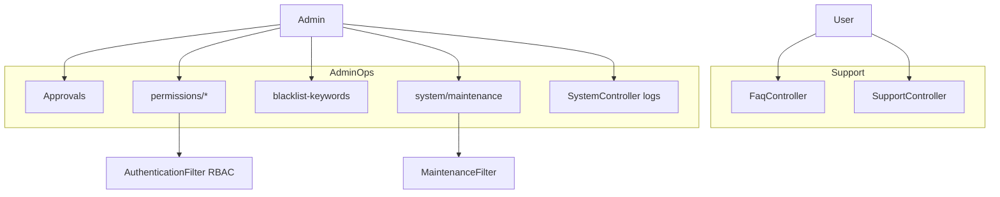

# Tài liệu Quy trình: Support & Admin (FAQ, Khiếu nại, RBAC, Hệ thống)

Tài liệu gom các **sub-flow** vận hành: FAQ, Appeal/Complaint, duyệt hồ sơ (overview), **RBAC permissions**, blacklist, maintenance, system logs.

---


---

## Phần A — UI Interaction Trace (Nút bấm → Code → Data → Hiển thị)

> UI Trace — Admin / Support  
> Mỗi thao tác trả lời: **nút ở đâu** · **bấm chạy file/hàm nào** · **API/BE đâu** · **data trả về** · **hiển thị thế nào**.


---

### UT-ADM-01 — Duyệt / Từ chối hồ sơ & sản phẩm

#### 1. Giao diện

| Mục | Giá trị |
|-----|---------|
| **Route** | `/admin/approvals` |
| **Page** | `pages/admin/AdminApprovalsPage.tsx` |
| **Tabs** | sellers / shippers / products |
| **Nút** | Duyệt / Từ chối / NeedsInfo → `openActionModal(...)` |
| **Confirm** | Modal form `onSubmit` → `handleActionSubmit` |

#### 2. Frontend

```text
handleActionSubmit
  → validate lý do nếu reject/needsInfo
  → sellers:  adminService.approveSellerApplication({ id, action, rejectionReason? })
  → shippers: adminService.approveShipperApplication(...)
  → products: adminService.approveProduct({ productId, isApproved, rejectionReason? })
```

#### 3. Backend

```text
POST /Admin/ApproveSellerApplication
POST /Admin/approve-shipper-application
POST /Admin/ApproveProduct
  → cập nhật ApplicationStatus / ProductStatus
  → có thể tạo RestaurantProfile / ShipperProfile khi Approved
  → Notification cho user
```

#### 5. Hiển thị

| Approve | toast `Đã phê duyệt thành công!` + reload list |
| Reject | toast `Đã từ chối đơn đăng ký.` |
| NeedsInfo | toast `Đã gửi yêu cầu bổ sung.` |
| Missing reason | toast `Vui lòng nhập lý do/thông báo.` — không gọi API |

Realtime: `notificationRealtimeService.onNotification` → refresh danh sách.

---

### UT-ADM-02 — FAQ CRUD

#### 1. Giao diện

`AdminFaqPage.tsx` — Thêm / Sửa / Xóa.

#### 2–3.

```text
POST /Faq · PUT /Faq/{id} · DELETE /Faq/{id}
GET /Faq (public Help center cũng đọc)
```

#### 5. Hiển thị

toast thêm/cập nhật/xóa thành công; validate `Vui lòng nhập câu hỏi/câu trả lời`.

---

### UT-ADM-03 — Blacklist keywords

`AdminBlacklistPage.tsx`:

```text
GET/POST/DELETE /Admin/blacklist-keywords*
PUT toggle
→ toast CRUD; từ khóa dùng khi filter review/chat (BlacklistFilterService)
```

---

### UT-ADM-04 — Lưu phân quyền Role

#### 1. Giao diện

`AdminPermissionsPage.tsx` — chọn role, tick endpoints → Lưu.

#### 2–3.

```text
GET /Admin/permissions/endpoints
GET /Admin/permissions/role/{role}
PUT /Admin/permissions/role/{role}  { grants... }
  → ROLE_PERMISSION
```

#### 5. Hiển thị

toast lưu thành công (**Critical** — ảnh hưởng 403 toàn hệ thống).

---

### UT-ADM-05 — Bật/Tắt bảo trì

#### 1. Giao diện

`AdminSystemConfigPage.tsx` — toggle maintenance.

#### 2–3.

```text
GET/POST /Admin/system/maintenance
  → SystemConfig
  → MaintenanceFilter trả 503 cho user thường
```

#### 5. Hiển thị

toast cập nhật bảo trì; FE `HttpClient` gặp 503 → redirect `/maintenance`.

---

### UT-SUP-01 — User gửi khiếu nại đơn (`UserReportIncidentPage`)

#### 1. Giao diện

| Mục | Giá trị |
|-----|---------|
| **Route** | `/support/report` |
| **Page** | `pages/support/UserReportIncidentPage.tsx` |
| **Submit** | `handleSubmit` |

#### 2. Frontend

```text
validate order + lý do + mô tả
handleImageUpload → uploadImage
supportService.orderComplaint(...) → POST /Support/order-complaint
```

#### 5. Hiển thị

toast `Gửi khiếu nại thành công! Chúng tôi sẽ xem xét trong 24h.`; validate thiếu field → toast error.

---

### UT-SUP-02 — Seller Appeal

#### 1. Giao diện

`SellerAppealPage.tsx` — form lý do → `handleSubmit`.

#### 2–3.

```text
POST /Support/appeal (Seller/Mall only)
```

#### 5. Hiển thị

toast gửi thành công chờ Admin; 403 nếu không phải Seller → toast Forbidden message.

---

### UT-ADM-06 — Xử lý khiếu nại (Admin)

`AdminOrderComplaintsPage.tsx` — nút xử lý → toast `Đã xử lý khiếu nại thành công` (moderate/resolve API).

Coordinator resolve: xem [10_Coordinator_UI_Trace.md](./10_Coordinator_UI_Trace.md) UT-COO-05.

---

## Sơ đồ Approvals




---

## Phần B — Workflow nghiệp vụ & Backend (chi tiết luồng)
## 1. Luồng Tổng Quan

1. **FAQ:** Public đọc `GET /api/Faq` — Admin CMS POST/PUT/DELETE.
2. **Khiếu nại:** User `POST /api/Support/appeal|order-complaint|shipper-complaint` → `SYSTEM_REPORT`.
3. **Admin approvals:** Seller/Shipper/Product — xem [Restaurant_Seller](./Restaurant_Seller_Workflow.md), [Product_Catalog](./Product_Catalog_Workflow.md), Shipper docs.
4. **RBAC:** Admin xem endpoints + gán quyền role → `API_ENDPOINT` / `ROLE_PERMISSION`.
5. **Blacklist:** CRUD từ khóa → dùng khi chat/filter.
6. **Maintenance:** Bật bảo trì → `MaintenanceFilter` trả 503 (trừ login/admin).
7. **Logs:** `GET /api/System/action-logs`, `error-logs`.



---

## Sub-flow A — FAQ

| Method | Route | Auth |
|--------|-------|------|
| GET | `/api/Faq` | Public |
| GET | `/api/Faq/{id}` | Public |
| POST | `/api/Faq` | Admin |
| PUT | `/api/Faq/{id}` | Admin |
| DELETE | `/api/Faq/{id}` | Admin |

**Files:** `FaqController.cs`, `FaqService.ts`, `HelpCenterPage.tsx`, `AdminFaqPage.tsx`  
**DB:** `FAQ`

---

## Sub-flow B — Appeal & Complaints

**Controller:** `SupportController.cs`

```csharp
[HttpPost("appeal")]
public async Task<ActionResult<ApiResponse>> SubmitAppeal([FromBody] SubmitAppealCommand command)
{
    var response = await _mediator.Send(command);
    return StatusCode(response.Code, response);
}

[HttpPost("order-complaint")]
public async Task<ActionResult<ApiResponse>> SubmitOrderComplaint([FromBody] SubmitOrderComplaintCommand command)
{
    if (userDto != null) command.CurrentUserId = userDto.Id;
    var response = await _mediator.Send(command);
    return StatusCode(response.Code, response);
}

[HttpPost("shipper-complaint")]
public async Task<ActionResult<ApiResponse>> SubmitShipperComplaint([FromBody] SubmitShipperComplaintCommand command)
{ ... }
```

| API | FE | Mục đích |
|-----|-----|----------|
| `POST /api/Support/appeal` | `SellerAppealPage` / report | Khiếu nại hệ thống / treo quán |
| `POST /api/Support/order-complaint` | `UserReportIncidentPage` | Khiếu nại đơn |
| `POST /api/Support/shipper-complaint` | Report pages | Khiếu nại shipper |

**DB:** `SYSTEM_REPORT` (`ReportTargetType`, `ReportStatus`).  
**Xử lý tiếp:** Admin/Coordinator moderate — `AdminController` review/product-reports, `CoordinatorController` complaint resolve.

**Legal public:** `GET /api/System/legal` — Terms/Privacy pages.

---

## Sub-flow C — Admin Approvals (overview)

| API | Việc | Workflow chi tiết |
|-----|------|-------------------|
| `GET /api/Admin/SellerApplications` | DS đơn seller | Restaurant_Seller |
| `POST /api/Admin/ApproveSellerApplication` | Duyệt seller/Mall | Restaurant_Seller |
| `GET /api/Admin/ShipperApplications` | DS shipper | Register / Shipper |
| `POST /api/Admin/approve-shipper-application` | Duyệt shipper | — |
| `POST /api/Admin/ApproveProduct` | Duyệt món | Product_Catalog |
| `PUT /api/Admin/suspend-restaurant` | Treo quán | — |
| `POST /api/Admin/Restaurants/{id}/toggle-verification` | Verify quán | — |

**FE:** `AdminApprovalsPage.tsx`, `AdminService.ts`.

---

## Sub-flow D — RBAC Permissions

| Method | Route | Việc |
|--------|-------|------|
| GET | `/api/Admin/permissions/endpoints` | DS ApiEndpoint |
| GET | `/api/Admin/permissions/role/{role}` | Quyền theo role |
| PUT | `/api/Admin/permissions/role/{role}` | Cập nhật RolePermission |

**FE:** `AdminPermissionsPage.tsx`

```typescript
async getApiEndpoints() { ... }
async getRolePermissions(role: number) { ... }
async updateRolePermissions(role: number, endpointIds: string[]) { ... }
```

**Runtime check:** `AuthenticationFilter` — UserPermission override → RolePermission; **Admin bypass**.  
**Seed:** `API/Data/ApiEndpointSeeder.cs` lúc startup.  
**DB:** `API_ENDPOINT`, `ROLE_PERMISSION`, `USER_PERMISSION`.

---

## Sub-flow E — Blacklist keywords

| Method | Route |
|--------|-------|
| GET | `/api/Admin/blacklist-keywords` |
| POST | `/api/Admin/blacklist-keywords` |
| DELETE | `/api/Admin/blacklist-keywords/{id}` |
| PUT | `/api/Admin/blacklist-keywords/{id}/toggle` |

**FE:** `AdminBlacklistPage.tsx`  
**Dùng bởi:** `BlacklistFilterService` (chat, có thể content khác).  
**DB:** `BLACKLIST_KEYWORD`.

---

## Sub-flow F — Maintenance & System config

| Method | Route | Việc |
|--------|-------|------|
| GET/POST | `/api/Admin/system/maintenance` | Đọc/bật bảo trì |
| GET/POST | `/api/Admin/system/delivery` | Config giao hàng global |
| POST | `/api/Admin/system/legal` | Cập nhật điều khoản |

**Filter:** `MaintenanceFilter` — khi bảo trì → HTTP **503** (FE `HttpClient` redirect `/maintenance`).  
**FE:** `AdminSystemConfigPage.tsx`, `AdminLegalSettingsPage.tsx`, `MaintenancePage.tsx`.  
**DB:** `SYSTEM_CONFIG` (PK = Key).

---

## Sub-flow G — System Logs

| Method | Route | Context |
|--------|-------|---------|
| GET | `/api/System/action-logs` | `LogContext` schema `log` |
| GET | `/api/System/error-logs` | ErrorLog |
| GET | `/api/System/legal` | Public legal |
| GET | `/api/System/global-menu-category` | Public categories |

**FE:** `AdminSystemLogsPage.tsx` — `AdminService.getActionLogs` / `getErrorLogs`.  
**Ghi log:** `AuthenticationFilter` → ActionLog; `ExceptionHandlingMiddleware` → ErrorLog.

---

## Call chain (Admin ops)

```text
Admin*Page / HelpCenter / Report pages
  ↓
AdminService / FaqService / SupportService
  ↓
AdminController / FaqController / SupportController / SystemController
  ↓
Features/Admin | Faqs | Support | System Queries
  ↓
SYSTEM_REPORT / FAQ / API_ENDPOINT / ROLE_PERMISSION / BLACKLIST / SYSTEM_CONFIG / log.*
```

---

## Toast / Message

| Nơi | Trigger |
|-----|---------|
| AdminFaqPage | CRUD FAQ |
| SellerAppeal / UserReport | Submit appeal/complaint |
| AdminPermissionsPage | Update role permissions |
| AdminBlacklistPage | CRUD keyword |
| AdminSystemConfig | Bật maintenance |
| HttpClient | 503 → `/maintenance` |

---

## Bảo mật

1. Hầu hết Admin APIs — role Admin (seeder catch-all `/api/admin/`).
2. Support complaint cần Auth + CurrentUserId.
3. Đổi RBAC có hiệu lực request sau (filter đọc DB).
4. Maintenance không chặn Admin/login (theo filter).
5. Logs chứa audit — chỉ Admin.

---

## Checklist

- [ ] FAQ public + Admin CRUD
- [ ] Appeal / order-complaint / shipper-complaint tạo SystemReport
- [ ] Permissions UI đổi role → endpoint bị 403/200 đúng
- [ ] Blacklist ảnh hưởng chat
- [ ] Bật maintenance → user thường 503, login vẫn được
- [ ] Action/Error logs hiển thị

---

## Tóm tắt

Support = FAQ + khiếu nại; Admin ops = duyệt + **RBAC** + blacklist + maintenance + logs. Chi tiết duyệt Seller/Product xem workflow riêng.

> [Chat_Notification_Workflow.md](./Chat_Notification_Workflow.md) · [Restaurant_Seller_Workflow.md](./Restaurant_Seller_Workflow.md) · [README](./README.md)
