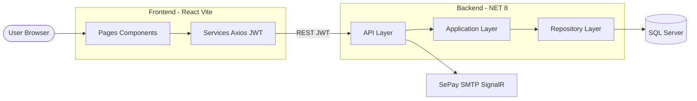
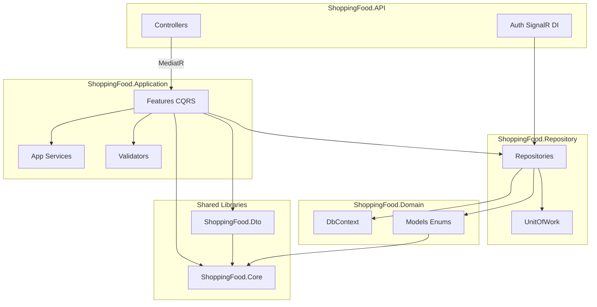
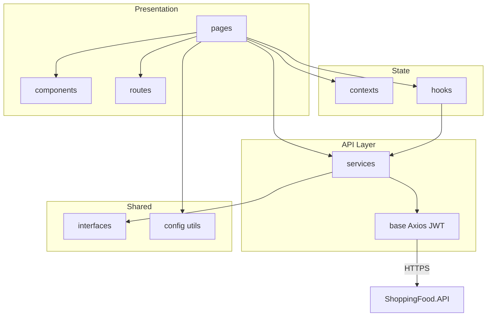

# UniEats — Package Diagrams

Chỉ mô tả **code production** (không gồm Tests / e2e).

---

## 1. Toàn hệ thống

Luồng: **User → Frontend → API → Business → Data → Database**



---

## 2. Backend

Luồng phụ thuộc: **Controllers → Handlers → Repositories → Domain**



### Modules trong Application

| Nhóm | Features |
|------|----------|
| Người dùng | Users, UserAddresses |
| Mua hàng | Carts, Orders, Payments |
| Catalog | Products, Restaurants, Discounts, FlashSales, Promotions |
| Vận hành | Shippers, Coordinator, Chat, Support |
| Quản trị | Admin, System, Faqs, Notifications, LoyaltyPoints |

### Project references

```
ShoppingFood.API
  └── ShoppingFood.Application
  └── ShoppingFood.Repository

ShoppingFood.Application
  └── ShoppingFood.Repository
  └── ShoppingFood.Domain
  └── ShoppingFood.Dto
  └── ShoppingFood.Core

ShoppingFood.Repository
  └── ShoppingFood.Domain
  └── ShoppingFood.Dto
  └── ShoppingFood.Core

ShoppingFood.Domain / Dto
  └── ShoppingFood.Core
```

---

## 3. Frontend

Luồng: **Pages → Hooks Contexts → Services → API**



### Pages theo role

| Role | Thư mục |
|------|---------|
| Khách / Customer | `shared` |
| Seller | `seller` |
| Shipper | `shipper` |
| Coordinator | `coordinator` |
| Admin | `admin` |
| Khác | `payment`, `support` |

### Services chính

`AuthService` · `CartService` · `OrderService` · `ProductService` · `RestaurantService` · `PaymentService` · `DiscountService` · `AdminService` · `ShipperService` · `NotificationService` · …

---

## Cách xem

1. Cursor / VS Code: mở file → `Ctrl+Shift+V`
2. Export hình: copy block `mermaid` → [mermaid.live](https://mermaid.live) → Export PNG/SVG
