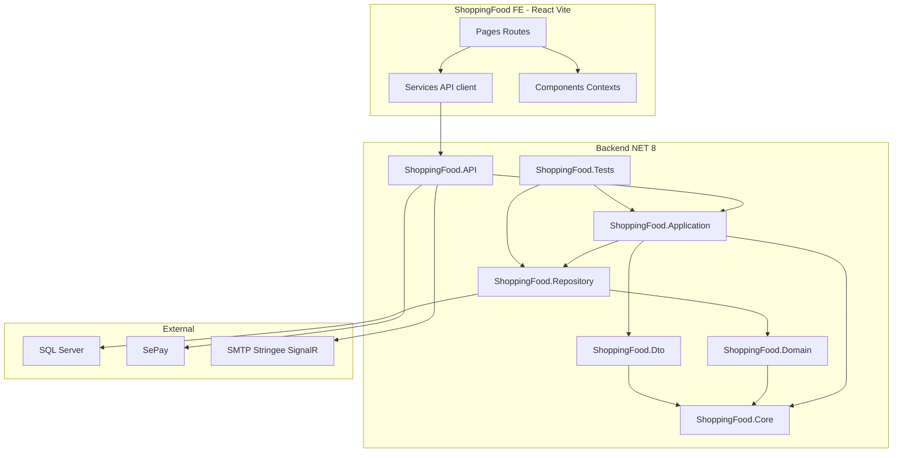
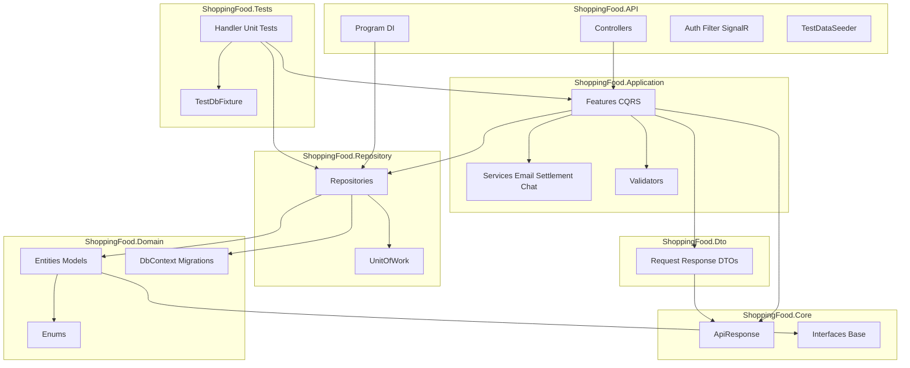
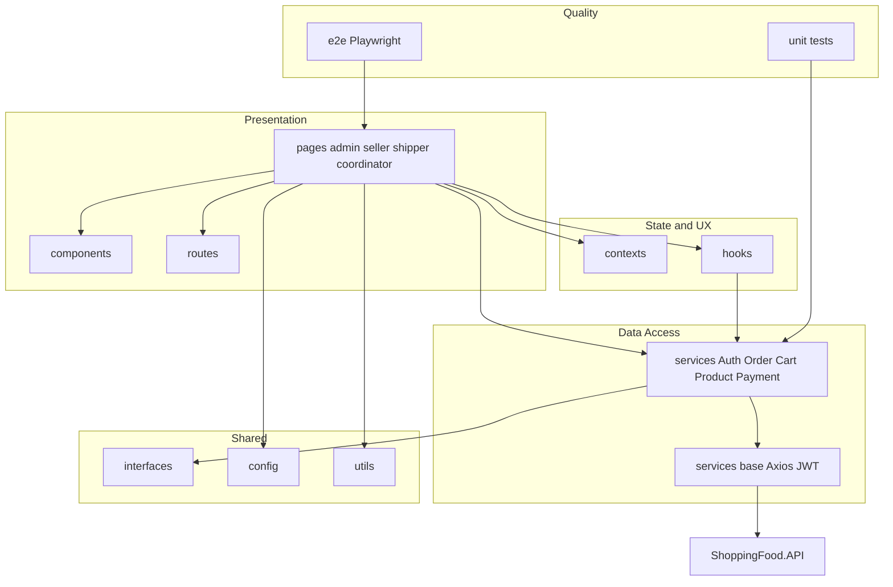

# Shopping Food — Package Diagrams

Tài liệu mô tả cấu trúc package của toàn hệ thống, backend (.NET 8) và frontend (React).

> Diagram dùng cú pháp Mermaid đơn giản, tương thích Cursor / VS Code / GitHub / mermaid.live.

---

## 1. Toàn dự án (System)

---

## 2. Backend (Clean Architecture)

### Project references

| Project | Depends on |
|---------|------------|
| `ShoppingFood.API` | Application, Repository |
| `ShoppingFood.Application` | Domain, Dto, Core, Repository |
| `ShoppingFood.Repository` | Domain, Dto, Core |
| `ShoppingFood.Domain` | Core |
| `ShoppingFood.Dto` | Core |
| `ShoppingFood.Tests` | Application, Repository |

**Dependency direction (không đảo ngược):**  
`API → Application → Repository → Domain`  
`Dto` / `Core` dùng chung; `Tests` phụ thuộc Application + Repository.

### Application Features

`Admin`, `Carts`, `Chat`, `Coordinator`, `Discounts`, `Faqs`, `FlashSales`, `LoyaltyPoints`, `Notifications`, `Orders`, `Payments`, `Products`, `Promotions`, `Restaurants`, `Shippers`, `Support`, `System`, `UserAddresses`, `Users`

---

## 3. Frontend (ShoppingFood.FE)

### `src/` layout

| Folder | Responsibility |
|--------|----------------|
| `pages/` | Màn hình theo role: `admin`, `seller`, `shipper`, `coordinator`, `shared`, `payment`, `support` |
| `components/` | UI tái sử dụng |
| `routes/` | React Router |
| `contexts/` | Auth / app state |
| `hooks/` | Custom hooks |
| `services/` | API clients (Auth, Order, Cart, Product, Payment, Admin, …) |
| `services/base/` | Axios instance + JWT |
| `interfaces/` | TypeScript contracts |
| `config/` | Env / app config |
| `utils/` | Helpers |
| `__tests__/` | Unit tests FE |
| `e2e/` | Playwright walkthrough / evidence |

---

## Cách xem diagram

1. Mở file này trong Cursor → **Markdown Preview** (`Ctrl+Shift+V`)
2. Hoặc copy từng block `mermaid` vào [https://mermaid.live](https://mermaid.live) → **Export PNG/SVG**
3. Nếu preview vẫn trắng: cài extension **Markdown Preview Mermaid Support**
