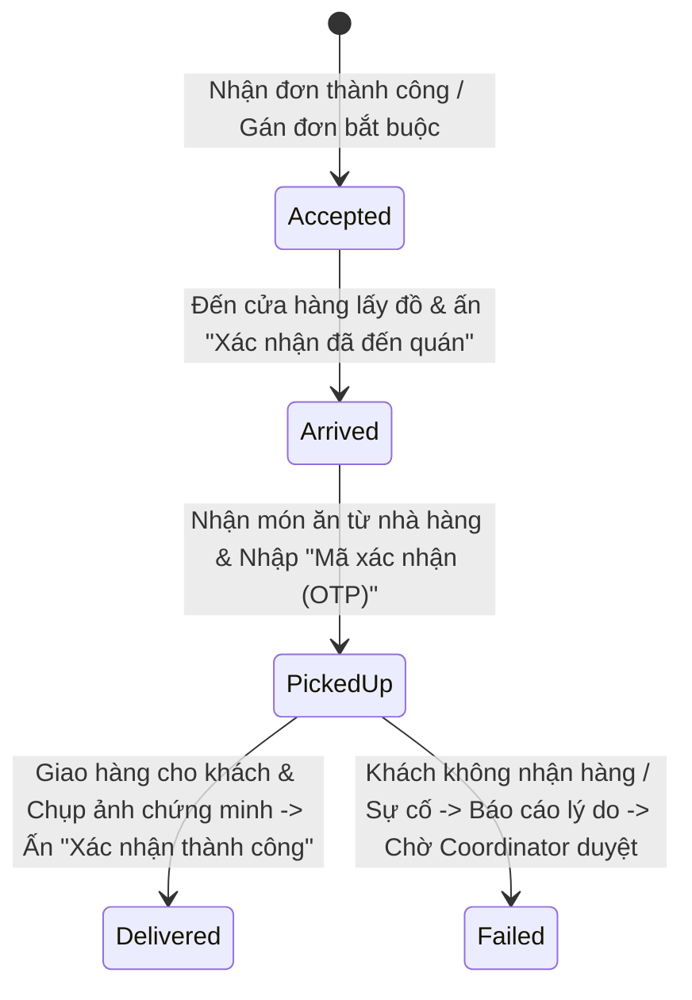
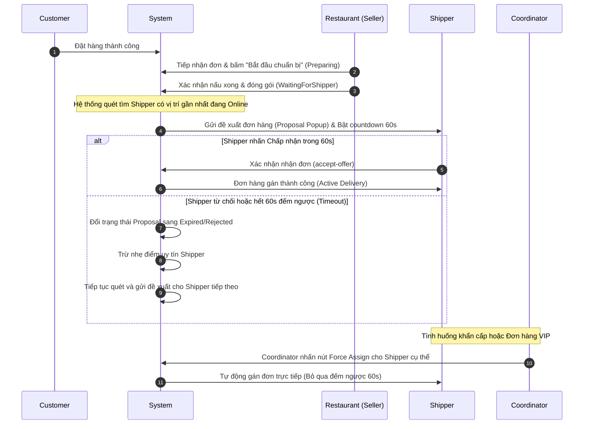
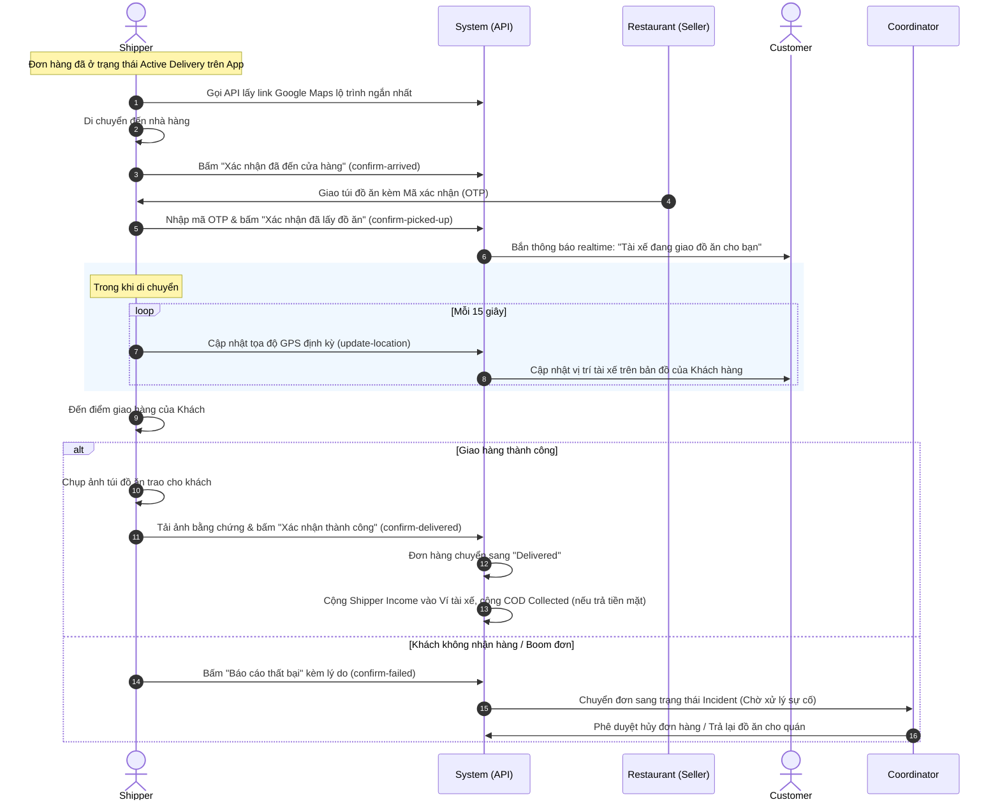
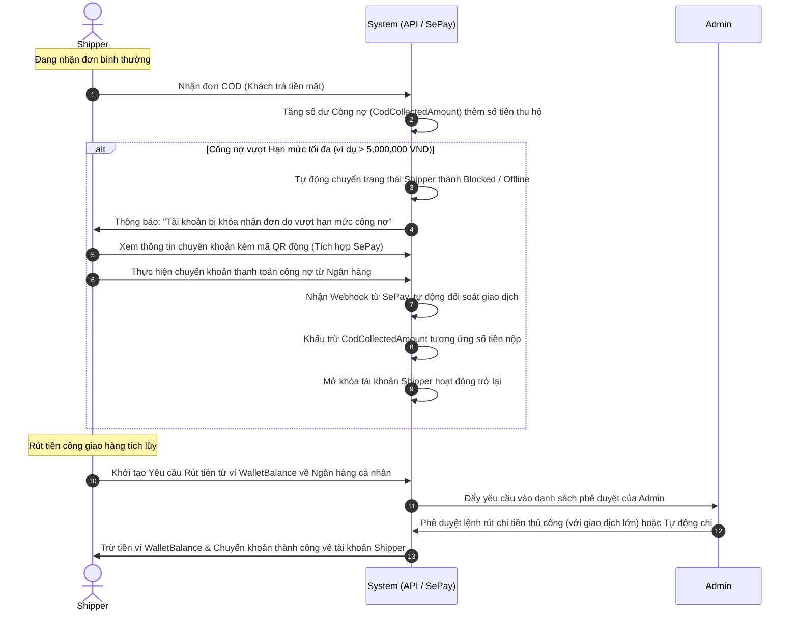

# Đặc tả Yêu cầu Nghiệp vụ (Requirements) - Phân hệ Shipper & Logistics
**Dự án:** Shopping Food (Nền tảng Marketplace đặt & giao đồ ăn trực tuyến)  
**Tác giả:** BA & AI Agent Pair-Programming System  

---

## 1. Phạm vi Dự án (Project Scope)

### 1.1. Trong Phạm vi (In-Scope)
Hệ thống **Shopping Food** được xây dựng là một Marketplace B2C kết nối Khách hàng, Cửa hàng (Seller) và Tài xế (Shipper) dưới sự điều phối của Điều phối viên (Coordinator) và Admin. Các phân hệ nghiệp vụ chính bao gồm:
*   **Authentication & Profile:** Quản lý đăng ký, đăng nhập (hỗ trợ Google/Microsoft OAuth, OTP), xác thực đa phân hệ cho Khách hàng, Seller, Shipper, Coordinator, và Admin.
*   **Product & Menu Management:** Quản lý danh mục thực đơn, món ăn, kích cỡ (Size), topping đi kèm.
*   **Order & Cart Management:** Giỏ hàng linh hoạt, đặt hàng online, đặt hàng vãng lai (Guest Checkout) và theo dõi trạng thái đơn hàng thời gian thực qua WebSockets (SignalR).
*   **Logistics & Shipping Management (Trọng tâm):**
    *   Hồ sơ ứng tuyển Shipper (CMND/CCCD, Bằng lái, Giấy tờ xe) và quy trình duyệt tài xế của Admin.
    *   Bật/Tắt trạng thái trực tuyến (Online/Offline) và cập nhật tọa độ GPS định kỳ (15s) từ thiết bị.
    *   Hệ thống ghép đơn tự động (Auto-Match) dựa trên khoảng cách địa lý và gợi ý Shipper thông minh.
    *   Quy trình đề xuất đơn hàng (Proposal) đếm ngược 60 giây và tính năng Gán đơn bắt buộc (Force Assign).
    *   Quy trình giao hàng 3 bước (Stepper): Xác nhận đến quán -> Xác nhận đã lấy hàng (nhập mã OTP từ quán) -> Xác nhận giao thành công (chụp ảnh bằng chứng) hoặc báo cáo thất bại (incident).
*   **Payment & Finance Management:**
    *   Thanh toán trả trước qua Ví tích lũy hệ thống, Cổng SePay QR (đối soát tự động bằng webhook) hoặc trả sau bằng Tiền mặt (COD).
    *   Quản lý ví tài chính cho cả Khách hàng, Seller, Shipper và doanh thu sàn (Platform Wallet).
    *   Quản lý hạn mức công nợ COD của tài xế (Debt Limit) và cơ chế nộp tiền hoàn công nợ khi vượt hạn mức.
*   **Support & Trust Management:** Đánh giá chất lượng phục vụ (Rating), khiếu nại đơn hàng, báo cáo sự cố (khách boom hàng, nhà hàng làm lâu) và quản lý điểm uy tín (Reputation Score) của tài xế.
*   **Coordinator Dispatch Board:** Bảng điều khiển thời gian thực giám sát bản đồ GPS shipper, gán đơn, rút đơn, chuyển đơn (Reassign) và phê duyệt xử lý sự cố.

### 1.2. Ngoài Phạm vi (Out-of-Scope)
*   **AI Recommendation Engine:** Chưa hỗ trợ thuật toán AI tự động gợi ý món ăn nâng cao theo hành vi người dùng (hiện tại lọc theo các tiêu chí cơ bản: bán chạy, khoảng cách, danh mục).
*   **Native Mobile App (iOS/Android):** Hiện tại hệ thống triển khai trên giao diện Web Responsive tối ưu trên trình duyệt di động (Mobile Web) cho tài xế và khách hàng.
*   **SMS Gateway thương mại:** Tích hợp OTP qua email hoặc giả lập SMS, chưa ký hợp đồng thương mại với Telco Brandname để gửi tin nhắn SMS trực tiếp.

---

## 2. Yêu cầu Nghiệp vụ cho Vai trò Shipper (Shipper Requirements)

### 2.1. Đăng ký & Xét duyệt hồ sơ Shipper (UC-SHIP-001, UC-SHIP-002)
*   **Mô tả:** Người dùng (chưa đăng nhập hoặc là Customer) nộp đơn đăng ký làm Shipper đối tác.
*   **Thông tin đầu vào:**
    *   *Thông tin cơ bản:* Họ tên, Số điện thoại, Email, Số CMND/CCCD.
    *   *Thông tin phương tiện:* Loại xe (Xe máy, Xe máy điện, Ô tô), Biển kiểm soát.
    *   *Tài liệu đính kèm (Ảnh chụp):* Mặt trước CMND/CCCD, Mặt sau CMND/CCCD, Bằng lái xe, Giấy đăng ký xe (Cà vẹt), Ảnh chân dung tài xế.
*   **Quy tắc nghiệp vụ (Business Rules):**
    *   Các file ảnh tải lên phải đúng định dạng (`.jpg`, `.jpeg`, `.png`, `.webp`) và dung lượng tối đa 5MB.
    *   Hồ sơ sau khi gửi sẽ ở trạng thái `Pending` (Chờ duyệt).
    *   Admin kiểm tra hồ sơ, đối chiếu thông tin và có quyền chọn `Approve` (Duyệt - tài khoản được nâng cấp thành Shipper) hoặc `Reject` (Từ chối - kèm lý do cụ thể).

### 2.2. Trạng thái Hoạt động & Cập nhật GPS (UC-SHIP-003, UC-SHIP-010)
*   **Mô tả:** Shipper quản lý trạng thái sẵn sàng nhận đơn và cung cấp tọa độ để hệ thống theo dõi và ghép đơn.
*   **Quy tắc nghiệp vụ:**
    *   Nút chuyển đổi **Online/Offline** trên Dashboard:
        *   Khi **Online**: Hệ thống bắt đầu quét định vị GPS từ trình duyệt/thiết bị của Shipper mỗi 15 giây qua API `location`. Shipper sẽ bắt đầu nhận được đề xuất đơn hàng xung quanh khu vực hoạt động.
        *   Khi **Offline**: Hệ thống ngừng theo dõi vị trí và không gửi đề xuất đơn mới (trừ trường hợp đơn hàng đang giao dở thì vẫn phải hoàn thành).
    *   *Vùng hoạt động:* Shipper có thể thiết lập **Khu vực hoạt động** (Tọa độ trung tâm và Bán kính hoạt động bằng km) và **Lịch làm việc mong muốn** trên trang cá nhân để tối ưu hóa gợi ý đơn hàng.

### 2.3. Quy trình Đề xuất & Tiếp nhận đơn hàng (Proposal / Match)
*   **Mô tả:** Cơ chế kết nối đơn hàng chờ giao với Shipper đang online.
*   **Quy tắc nghiệp vụ:**
    *   **Auto-Match (Hệ thống tự động đề xuất):** Khi đơn hàng chuyển sang trạng thái `WaitingForShipper`, hệ thống tìm kiếm tài xế online gần nhà hàng nhất dựa trên công thức khoảng cách địa lý.
    *   **Gửi đề xuất (Proposal):** Hệ thống khởi tạo một Proposal có thời gian đếm ngược **60 giây** (Countdown) hiển thị trên màn hình Shipper dưới dạng Pop-up cảnh báo kèm thông tin chi tiết:
        *   Tên & địa chỉ nhà hàng (Điểm lấy đồ ăn).
        *   Địa chỉ khách hàng (Điểm giao đồ ăn).
        *   Quãng đường giao (km) và Phí dịch vụ giao hàng thực nhận của Shipper (Shipper Income).
        *   Hình thức thanh toán (COD hay Trả trước).
    *   **Phản hồi của Shipper:**
        *   *Chấp nhận (Accept):* Nhấn Đồng ý trong vòng 60s -> Đơn hàng gán cho Shipper (`Status = Shipping`), Proposal chuyển thành `Accepted`. Shipper bắt đầu đi lấy hàng.
        *   *Từ chối (Reject):* Nhấn Từ chối -> Đơn hàng được đẩy lại danh sách chờ gán cho tài xế khác.
        *   *Hết giờ (Expired/Timeout):* Sau 60s không phản hồi -> Hệ thống tự động từ chối đề xuất, trừ điểm uy tín nhẹ của tài xế và tìm tài xế khác.
    *   **Gán đơn bắt buộc (Force Assign):** Coordinator từ Dispatch Board có quyền gán trực tiếp đơn hàng cho Shipper bất kỳ đang Online mà không cần chờ 60s đếm ngược. Hệ thống sẽ tự động chuyển đơn thành Active Delivery trên ứng dụng của Shipper.

### 2.4. Quy trình Thực hiện Giao hàng (Stepper Delivery Process)
Quy trình giao hàng bắt buộc thực hiện qua 3 bước nghiêm ngặt trên giao diện của Shipper:

1.  **Bước 1: Di chuyển đến quán (Status: Shipping, Sub-step: Accepted)**
    *   Shipper xem bản đồ định vị và lộ trình đường đi tối ưu thông qua liên kết Google Maps Navigation được hệ thống tự động sinh từ API `delivery-route/{orderId}`.
    *   Khi tới quán, Shipper nhấn nút **"Xác nhận đã đến cửa hàng"**. Hệ thống ghi nhận mốc thời gian phục vụ và chuyển bước sang `arrived`.
2.  **Bước 2: Nhận món từ nhà hàng (Status: Shipping, Sub-step: Arrived)**
    *   Nhà hàng nấu xong và bàn giao đồ ăn cho Shipper kèm **Mã xác nhận lấy hàng** (Mã OTP gồm 4-6 số được sinh tự động trên giao diện Seller).
    *   Shipper nhập Mã xác nhận này vào ứng dụng -> Nhấn **"Xác nhận đã lấy hàng"**. Nếu mã chính xác, trạng thái chuyển sang `picked_up`. Đơn hàng chính thức rời quán.
3.  **Bước 3: Giao cho khách hàng (Status: Shipping, Sub-step: Picked_up)**
    *   Shipper di chuyển đến địa chỉ của khách hàng (Có thể nhấn nút gọi điện/nhắn tin trực tiếp từ App).
    *   **Trường hợp Giao hàng Thành công:**
        *   Shipper mở camera chụp lại bức ảnh chứng minh giao hàng thành công (ảnh đồ ăn trao cho khách hoặc ảnh đặt ở cửa/lễ tân).
        *   Hệ thống gọi API `confirm-delivered` kèm tọa độ thực tế và Link ảnh bằng chứng.
        *   Hệ thống cập nhật Đơn hàng thành `Delivered`, tự động kết toán tài chính.
    *   **Trường hợp Giao hàng Thất bại (Sự cố):**
        *   Nếu khách không nghe máy (sau ít nhất 3 cuộc gọi cách nhau 5 phút) hoặc khách từ chối nhận (boom hàng), Shipper nhấn **"Báo cáo giao hàng thất bại"**.
        *   Nhập lý do cụ thể và gửi báo cáo sự cố (`confirm-failed`).
        *   Hệ thống chuyển trạng thái đơn hàng sang dạng tranh chấp/sự cố chờ Điều phối viên (Coordinator) xử lý phê duyệt thủ công (`ResolveIncident`).

### 2.5. Quản lý Tài chính, Ví & Công nợ (UC-PAY-008, UC-PAY-013, UC-PAY-014)
*   **Ví Tài chính Shipper gồm 2 số dư quản lý song song:**
    *   `WalletBalance` (Số dư Ví tích lũy): Số tiền Shipper kiếm được (Tiền công giao hàng + Thưởng). Số tiền này Shipper được rút về tài khoản ngân hàng cá nhân qua lệnh rút tiền (`WithdrawalRequest`).
    *   `CodCollectedAmount` (Công nợ thu hộ): Tổng số tiền mặt COD mà Shipper thu từ khách hàng đối với các đơn hàng thanh toán bằng tiền mặt.
*   **Quy tắc công nợ (Debt Limit):**
    *   Mỗi Shipper được thiết lập một **Hạn mức công nợ tối đa** (mặc định là `5,000,000 VND`).
    *   Khi tổng số tiền COD thu hộ (`CodCollectedAmount`) **vượt quá** hạn mức này, hệ thống sẽ tự động **khóa quyền nhận đơn mới** của Shipper (chuyển trạng thái hoạt động về Offline và không cho bật Online).
    *   Shipper phải thực hiện **Nộp tiền hoàn công nợ** (chuyển khoản ngân hàng về tài khoản công ty bằng SePay QR đối soát) để khấu trừ số dư công nợ về dưới hạn mức, sau đó tài khoản sẽ tự động kích hoạt lại.

### 2.6. Điểm Uy tín & Đánh giá (UC-SUP-002, UC-SUP-013)
*   **Chấm điểm Rating:** Sau khi giao hàng thành công, Khách hàng có quyền chấm điểm từ 1 - 5 sao kèm bình luận cho Shipper. Điểm trung bình hiển thị trực tiếp trên Profile của tài xế.
*   **Điểm uy tín (Reputation Score):**
    *   Bắt đầu với điểm mặc định là 100.
    *   Cộng điểm: Hoàn thành đơn hàng đúng giờ, chuỗi giao hàng liên tục.
    *   Trừ điểm: Hủy đơn hàng sau khi đã chấp nhận, từ chối đề xuất quá nhiều lần, trễ giờ giao vô lý hoặc bị khách hàng đánh giá 1 sao do thái độ.
    *   *Chế tài:* Nếu Điểm uy tín giảm xuống dưới mức quy định (ví dụ < 60), hệ thống hoặc Coordinator sẽ tự động tạm khóa hoạt động (`Suspend`) tài xế.

### 2.7. Báo cáo Sự cố trong Hành trình (UC-SUP-016, UC-SUP-017)
Trong lúc đi giao, Shipper có quyền gửi báo cáo khẩn cấp về hệ thống qua `ReportIncidentModal`:
*   *Báo cáo nhà hàng:* Quán chuẩn bị món quá lâu (om đơn quá 20 phút kể từ lúc shipper đến quán).
*   *Báo cáo khách hàng:* Khách hàng có thái độ đe dọa, quấy rối hoặc thông tin địa chỉ sai lệch hoàn toàn.
*   Các sự cố này được chuyển thẳng đến màn hình của Coordinator để hỗ trợ can thiệp (hủy đơn không phạt tài xế hoặc đổi tài xế khác).

---

## 3. Luồng Hoạt động của Phần mềm (Software Workflows)

### 3.1. Luồng Điều phối & Tiếp nhận Đơn hàng (Proposal & Dispatch Flow)

### 3.2. Luồng Vận hành Giao hàng của Shipper (Delivery Execution Flow)

### 3.3. Luồng Quản lý Tài chính & Ví Shipper (Finance & Remittance Flow)

---

## 4. Bộ Câu hỏi của BA & Cách Trả lời làm rõ Nghiệp vụ (BA Q&A)

Dưới đây là tập hợp các câu hỏi chất vấn nghiệp vụ điển hình từ một BA (Business Analyst) nhằm làm rõ các quy tắc ràng buộc logic, xử lý ngoại lệ và trường hợp lỗi trong phân hệ Shipper, kèm theo giải pháp phản hồi thực tế đã được lập trình sẵn trong hệ thống:

### Q1: Làm thế nào để đảm bảo Shipper không gian lận tọa độ GPS (Fake GPS) để nhận các đơn hàng ngon hoặc giả vờ báo "đã đến quán" trong khi thực tế ở xa?
*   **BA phân tích:** Đây là rủi ro phổ biến trong logistics. Nếu tài xế ở xa mà vẫn báo "đã đến quán" nhằm chiếm dụng đơn hàng hoặc trốn phạt thời gian di chuyển sẽ làm giảm trải nghiệm của Seller và Khách hàng.
*   **Cách trả lời của hệ thống:**
    *   *Giải pháp kỹ thuật:* Backend thực hiện kiểm tra chéo khoảng cách (Geo-fencing) tại thời điểm gọi API.
    *   *Ràng buộc logic:* Khi Shipper gửi yêu cầu "Xác nhận đã đến cửa hàng" (`confirm-arrived`) hoặc "Xác nhận đã lấy hàng" (`confirm-picked-up`), tọa độ GPS hiện tại được gửi lên từ thiết bị di động sẽ được backend tính toán khoảng cách so với tọa độ cố định của nhà hàng lưu trong cơ sở dữ liệu (`RestaurantProfile.Latitude/Longitude`).
    *   *Quy tắc:* Nếu khoảng cách thực tế lớn hơn **200 mét** (giới hạn sai số GPS tối đa), hệ thống sẽ từ chối xử lý và báo lỗi: *"Bạn đang ở quá xa vị trí cửa hàng để thực hiện xác nhận này. Vui lòng di chuyển đến gần hơn."*

### Q2: Điều gì xảy ra nếu thiết bị của Shipper bị mất kết nối mạng (Offline đột ngột) khi đang đi giao hàng? Làm sao lưu trữ tiến trình?
*   **BA phân tích:** Khi shipper đi vào đường hầm, vùng sóng yếu, ứng dụng bị ngắt mạng. Nếu không lưu trữ, dữ liệu đơn hàng đang thực hiện bước nào có bị mất không?
*   **Cách trả lời của hệ thống:**
    *   *Giải pháp kỹ thuật:* Sử dụng kết hợp **Local Storage** trên trình duyệt của Shipper để đồng bộ trạng thái.
    *   *Ràng buộc logic:* Trạng thái đơn hàng đang giao (`activeDelivery`) bao gồm ID đơn, thông tin điểm lấy, điểm giao và bước hiện tại (`accepted`, `arrived`, `picked_up`) luôn được tự động lưu vào Local Storage mỗi khi có sự thay đổi trạng thái (xử lý trong hàm `useEffect` lắng nghe `activeDelivery` của màn hình `ShipperDashboard`).
    *   *Trải nghiệm:* Khi mạng bị ngắt rồi kết nối lại hoặc Shipper F5 tải lại trang, hệ thống sẽ đọc dữ liệu từ Local Storage để khôi phục lại đúng màn hình giao hàng cũ mà không yêu cầu tài xế phải thao tác lại từ đầu. Đồng thời, API cập nhật GPS định kỳ có cơ chế try-catch bỏ qua lỗi mạng tạm thời để tránh làm gián đoạn ứng dụng của tài xế.

### Q3: Tại sao lại cần mã xác nhận OTP lấy hàng từ nhà hàng? Quy trình này giải quyết vấn đề gì?
*   **BA phân tích:** Việc yêu cầu Shipper nhập mã xác nhận từ nhà hàng khi lấy đồ ăn làm tăng thêm một bước thao tác. Tại sao không cho phép tài xế tự nhấn "Đã lấy đồ ăn"?
*   **Cách trả lời của hệ thống:**
    *   *Mục đích nghiệp vụ:* Ngăn ngừa tình trạng lấy nhầm đơn hàng (đặc biệt khi quán đông khách có nhiều shipper cùng đứng chờ) hoặc tài xế gian lận tự bấm lấy hàng khi nhà hàng chưa chế biến xong nhằm đổ lỗi chuẩn bị chậm cho quán.
    *   *Ràng buộc logic:*
        1. Khi nhà hàng chuẩn bị xong món, hệ thống sinh ra một mã xác nhận ngẫu nhiên (chỉ hiển thị trên màn hình quản lý đơn hàng của Seller).
        2. Shipper khi đến lấy đồ ăn bắt buộc phải đọc đúng mã này hoặc nhờ chủ quán cung cấp mã để nhập vào ô xác thực trên ứng dụng.
        3. Chỉ khi mã nhập vào trùng khớp với mã lưu trữ trong DB của đơn hàng, API `confirm-picked-up` mới chấp nhận đổi trạng thái đơn sang `Shipping`. Đây là bằng chứng pháp lý chứng minh đơn hàng đã được bàn giao an toàn từ nhà hàng cho tài xế.

### Q4: Nếu một đơn hàng COD thu hộ tiền mặt bị giao thất bại (khách hàng không nhận hàng), số tiền COD thu hộ của tài xế sẽ xử lý thế nào? Có bị tính vào công nợ không?
*   **BA phân tích:** Đơn hàng COD khi giao thành công sẽ làm tăng công nợ thu hộ (`CodCollectedAmount`) của Shipper. Nhưng nếu giao thất bại, tiền mặt thực tế Shipper không thu được, công nợ có bị tăng vô lý không?
*   **Cách trả lời của hệ thống:**
    *   *Ràng buộc logic:* Số dư công nợ thu hộ (`CodCollectedAmount`) chỉ bị cộng dồn **sau khi** đơn hàng chuyển trạng thái thành công (`Delivered`).
    *   *Quy trình xử lý sự cố giao thất bại:*
        1. Khi Shipper bấm báo cáo giao thất bại (`confirm-failed`), trạng thái đơn hàng tạm thời chuyển sang trạng thái tranh chấp (Incident) và số tiền COD thu hộ chưa được ghi nhận vào ví.
        2. Lúc này, Coordinator sẽ nhảy vào kiểm duyệt sự việc thông qua API `ResolveIncident`.
        3. Nếu lỗi do khách hàng (Khách boom hàng), đơn hàng sẽ bị hủy, hoàn trả đồ ăn về quán hoặc xử lý tiêu hủy. Số tiền công nợ thu hộ của Shipper đối với đơn này ghi nhận bằng 0 (không tăng công nợ). Đồng thời hệ thống có thể bồi thường phí ship di chuyển cho Shipper tùy chính sách.
        4. Nếu lỗi cố ý từ Shipper (tài xế tự ý hủy, không liên hệ khách), tài xế sẽ bị trừ điểm uy tín nặng hoặc tạm khóa tài khoản.

### Q5: Khi thời gian đếm ngược 60 giây tiếp nhận đề xuất (Proposal Timeout) kết thúc mà tài xế không bấm nút, điểm uy tín của tài xế bị xử lý ra sao?
*   **BA phân tích:** Tài xế có thể bận lái xe không kịp bấm nút hoặc cố tình lờ đơn đi để chờ đơn khác ngon hơn. Trừ điểm uy tín thế nào để đảm bảo tính công bằng mà vẫn giữ chân được tài xế?
*   **Cách trả lời của hệ thống:**
    *   *Ràng buộc logic:* Khi Proposal hết hạn đếm ngược (gửi yêu cầu `Expired` lên backend), hệ thống sẽ:
        1. Chuyển trạng thái đề xuất thành `Expired`.
        2. Tự động giải phóng đơn hàng về danh sách điều phối chung để thuật toán Auto-Match tìm kiếm tài xế khác.
        3. Hệ thống gọi sự kiện ghi nhận lịch sử uy tín tài xế (`ShipperReputationHistory`). Điểm uy tín của Shipper sẽ bị khấu trừ nhẹ (ví dụ: trừ 1 điểm uy tín mỗi lần để trôi đơn).
        4. Nếu tài xế liên tiếp để trôi đơn 3 lần trong vòng 30 phút, hệ thống sẽ tự động chuyển trạng thái hoạt động của tài xế về Offline để tránh lãng phí thời gian điều phối đơn hàng và yêu cầu tài xế phải chủ động bật Online lại khi sẵn sàng làm việc.

### Q6: Cơ chế nào giúp hệ thống tính toán chi phí ship (Shipping Fee) trả cho Shipper và chiết khấu hoa hồng của sàn?
*   **BA phân tích:** Làm thế nào tính toán số tiền cộng vào ví `WalletBalance` của Shipper và doanh thu thực nhận của Sàn sau mỗi đơn thành công?
*   **Cách trả lời của hệ thống:**
    *   *Ràng buộc logic:* Tại thời điểm đặt đơn, hệ thống tính toán khoảng cách địa lý giữa nhà hàng và khách hàng (dựa trên bản đồ định vị).
    *   *Công thức tính phí:*
        *   `ShippingFee` (Phí ship thu từ khách): Tính theo khoảng cách (`Phí gốc + Phí theo mỗi km bổ sung`).
        *   `ShipperIncome` (Thu nhập thực nhận của Shipper): Bằng `Phí ship gốc (ShipperBaseFeeAmount) + Phí quãng đường (ShipperDistanceFeeAmount) + Phí thưởng giờ cao điểm (ShipperPeakBonus)`.
        *   `PlatformCommission` (Chiết khấu sàn thu từ Seller): Thường là % cố định (ví dụ: 15% - 20%) trên tổng tiền món ăn.
    *   *Hạch toán khi giao thành công:*
        *   Tiền món ăn sau khi trừ chiết khấu sàn (`SellerPayout = ItemsSubtotal - PlatformCommission`) được cộng vào ví của Seller.
        *   Tiền `ShipperIncome` được cộng vào ví tích lũy của Shipper (`WalletBalance`).
        *   Tiền chiết khấu sàn (`PlatformCommission`) cộng vào ví của Công ty.
        *   Nếu đơn hàng thanh toán COD: Shipper giữ tiền mặt của khách nên công nợ `CodCollectedAmount` của Shipper tăng thêm bằng đúng tổng tiền đơn hàng (`TotalAmount`), và Shipper sẽ phải đối soát nộp lại phần tiền thừa cho Công ty sau này.

---

## 5. Kết luận & Hướng Dẫn Vận Hành Thử Nghiệm (Test Run Guideline)

Tất cả các nghiệp vụ trên đã được thiết kế đồng bộ từ cơ sở dữ liệu (các bảng `ShipperProfile`, `ShipperApplication`, `OrderDeliveryProposal`) cho đến các API xử lý trong `ShipperController`, `CoordinatorController` và giao diện giao diện tài xế tại trang `/shipper` của Frontend.

### Để chạy thử nghiệm luồng Shipper trên hệ thống:
1.  **Đăng ký tài xế mới:** Truy cập trang đăng ký tài xế `/register/shipper` (hoặc `/shipper/apply` nếu đã đăng nhập), điền thông tin và tải lên các ảnh CMND/Bằng lái xe.
2.  **Duyệt tài xế:** Đăng nhập tài khoản Admin, truy cập `/admin/approvals` và bấm **Approve** hồ sơ Shipper vừa đăng ký.
3.  **Bật chế độ nhận đơn:** Đăng nhập tài khoản Shipper vừa được duyệt, truy cập `/shipper` (Dashboard Shipper) và click bật nút **"Trực tuyến"** (Online).
4.  **Đặt đơn:** Sử dụng một tài khoản Customer đặt một đơn hàng mới từ trang chủ.
5.  **Xử lý đơn tại quán:** Nhà hàng (Seller) vào tiếp nhận đơn, chuẩn bị món và bấm nấu xong.
6.  **Điều phối giao hàng:** 
    *   Màn hình Shipper sẽ nhận được Pop-up đếm ngược 60s hiển thị đơn đề xuất. Bấm **Đồng ý**.
    *   *Hoặc:* Đăng nhập tài khoản Coordinator, vào `/coordinator/dispatch` và dùng tính năng **Force Assign** gán đơn trực tiếp cho Shipper.
7.  **Hoàn tất giao hàng:** Trở lại Dashboard Shipper, thực hiện lần lượt các bước: Bấm **Xác nhận đến quán** -> Nhập mã OTP từ Seller để **Xác nhận lấy hàng** -> Nhấn **Hoàn thành giao hàng**, tải ảnh chụp món đồ ăn đã giao để hoàn tất đơn hàng.
